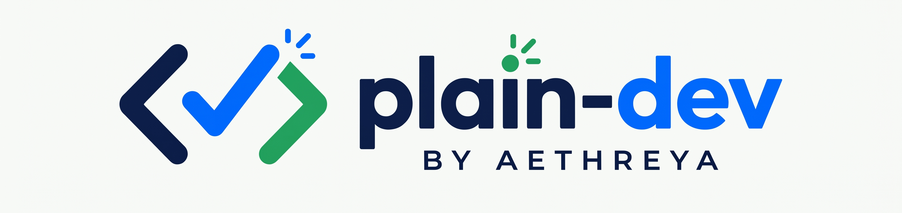

<p style="text-align: center;">
  
</p>

<h3 align="center">Software testing and coding, explained in plain English.</h3>

<p style="text-align: center;">
  <a href="https://akashgkrishna.github.io/plain-dev/"></a>
  <a href="#tech-stack"></a>
  <a href="LICENSE"></a>
</p>

---

## How Every Guide Works

1. **Tiny examples first** — See the idea in a few lines of code before any theory.
2. **Play with it** — Interactive sliders, steppers, and visualizers let you see how concepts behave in real time.
3. **Practice, then check** — Questions come first and explanations come after, just like a real technical interview.

---

## Guides & Roadmap

| Status             | Interactive Guide                                                                       | Topics Covered                                                                                 |
|:-------------------|:----------------------------------------------------------------------------------------|:-----------------------------------------------------------------------------------------------|
| 🟢 **Live**        | [**Big O Notation Without the Math**](https://akashgkrishna.github.io/plain-dev/big-o/) | Time & space complexity with a live growth slider, binary search stepper, and interactive quiz |
| 🟡 **Coming Soon** | **Selenium WebDriver Essentials**                                                       | Locators, explicit waits, and the Page Object Model, step by step                              |
| 🟡 **Coming Soon** | **REST Assured for Beginners**                                                          | Writing API tests in Java: `GET`, `POST`, assertions, and request chaining                     |
| 🟡 **Coming Soon** | **Java Collections Made Simple**                                                        | `ArrayList`, `HashMap`, and `HashSet`—and when to use each                                     |
| 🟡 **Coming Soon** | **SQL for Testers**                                                                     | `JOIN`, `GROUP BY`, and window functions using tiny tables                                     |
| 🟡 **Coming Soon** | **Test Framework Design**                                                               | Structuring a clean, maintainable, and scalable test automation framework                      |
| 🟡 **Coming Soon** | **CI/CD for Test Automation**                                                           | Running automated test suites on every push with GitHub Actions                                |

---

## Tech Stack

Built intentionally lightweight so every guide loads instantaneously on GitHub Pages:

* **Zero Frameworks & Zero Build Step:** Pure semantic HTML5, modern CSS, and dependency-free Vanilla JavaScript.
* **Custom Brand Identity:** Inline SVG **plain-dev by Aethreya** lockup, full-bleed favicon (`icon2.png`), brand
  assets (`logo.png`, `icon1.png`), and Open Graph social preview banner (`cover.png`).
* **Adaptive Dark & Light Mode:** Automatic OS theme detection via `prefers-color-scheme` using CSS custom properties.
* **Accessible & Responsive:** High-contrast keyboard focus rings, ARIA live regions for interactive demos, safe-area
  inset handling, and `prefers-reduced-motion` support.

### Repository Structure

```text
plain-dev/
├── big-o/
│   └── index.html      # Interactive Big O Notation guide
├── cover.png           # Open Graph social preview banner
├── icon1.png           # Brand icon asset (standard)
├── icon2.png           # Full-bleed browser tab favicon
├── index.html          # Live landing page & study guide directory
├── LICENSE             # Repository license
├── logo.png            # Full plain-dev by Aethreya logo lockup
└── README.md           # Project documentation
```

---

## Run Locally

No `npm install` or build tools required. Clone the repository and open `index.html` directly in your browser, or run a
local static server:

```bash
git clone [https://github.com/akashgkrishna/plain-dev.git](https://github.com/akashgkrishna/plain-dev.git)
cd plain-dev

# Serve locally using Python
python3 -m http.server 8080
```

Then visit `http://localhost:8080`.

---

## License & Author

Licensed under the terms in [`LICENSE`](LICENSE).  
Built while learning in public by **Akash** ([@akashgkrishna](https://github.com/akashgkrishna)) · **Aethreya**